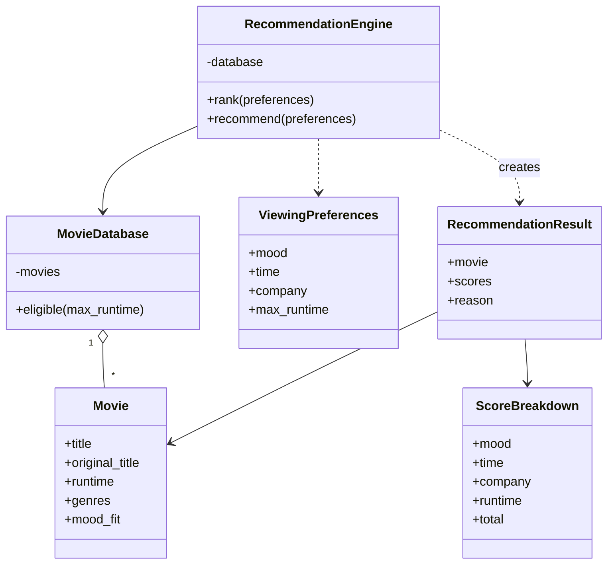
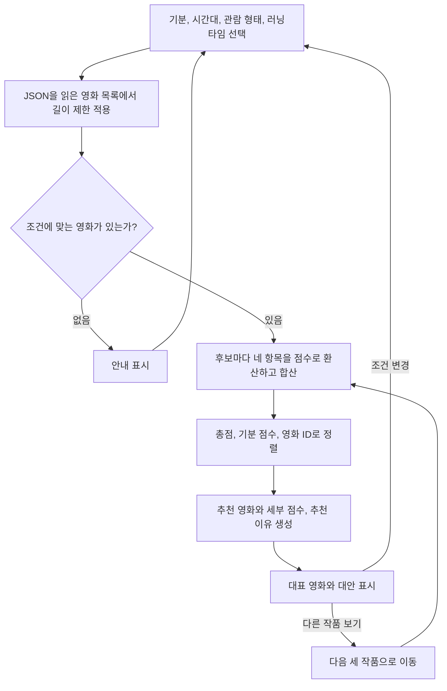

# SCENE 발표 준비 가이드

**지금, 어떤 영화를 보고 싶나요?**

## 1. 무엇을 만들었나

SCENE은 현재 기분과 상황을 입력하면 영화 24편 중 지금 보기 좋은 한 편과 대안 두 편을 보여주는 웹 앱입니다. 목표는 **더 많은 영화를 추천하는 것이 아니라, 지금 보고 싶은 한 편을 쉽게 찾게 하는 것**입니다.

발표 첫 문장 예시

> 저는 영화 고르는 데 30분 넘게 쓰곤 했습니다. 평소에는 복잡한 작품을 좋아해도 피곤한 날에는 가벼운 영화가 보고 싶었습니다. 그래서 지금의 기분을 묻고, 왜 그 영화가 어울리는지 설명하는 추천 앱을 만들었습니다.

제가 사용한 OTT 서비스에서는 추천의 기준이 제게 분명하게 느껴지지 않을 때가 있었고, 그날의 기분과 맞지 않는 작품이 보일 때가 있었습니다. SCENE에서는 기분·시간대·관람 형태·러닝타임을 내가 고르고, 각 조건이 몇 점을 더했는지 직접 확인할 수 있습니다.

## 2. 왜 Python인가

인공지능학과에서 관심을 가진 Python을 실제 서비스에 써 보고 싶었습니다. JSON에서 영화 한 편을 읽으면 Python의 딕셔너리가 됩니다. 그 값을 `Movie` 객체로 옮긴 뒤 점수를 계산하고, Streamlit에 결과를 넘겼습니다. 한 언어에서 데이터 처리와 웹 화면 구현을 이어갈 수 있어 발표용 프로젝트를 빠르게 완성할 수 있었습니다.

성능도 측정했습니다. 24편 규모에서 Python의 추천은 조건당 평균 30.84마이크로초였습니다. 동일한 순위 연산에서 C++가 더 빨랐고, SCENE의 선택에는 작은 데이터 규모와 개발 편의성도 고려했습니다.

## 3. 전체 구조와 객체지향 설계

영화관에서 여러 사람이 각자 일을 맡는 것처럼, 프로그램의 클래스도 일의 종류에 따라 역할을 나눕니다. `Movie`는 영화 한 편을 가진 정보 카드, `MovieDatabase`는 카드 묶음과 후보 목록, `RecommendationEngine`은 점수를 계산하는 사람, `RecommendationResult`는 그 계산 결과를 적은 추천표에 해당합니다.

| 클래스 | 맡은 일 |
| --- | --- |
| `Movie` | 한 작품의 제목, 개봉 연도, 장르, 러닝타임, 분위기, 이미지 파일 정보, 등급을 담고 등급의 형식을 확인합니다. |
| `MovieDatabase` | JSON에서 영화 객체를 만들고, 길이 제한을 지키는 영화만 돌려줍니다. |
| `ViewingPreferences` | 사용자가 고른 네 가지 조건을 보관하고 선택값을 검사합니다. |
| `RecommendationEngine` | 영화별 세부 점수를 계산하고 정렬하며 설명 문장을 만듭니다. |
| `ScoreBreakdown` | 기분, 시간대, 관람 형태, 러닝타임의 점수와 합계를 담습니다. |
| `RecommendationResult` | 선택된 한 작품, 세부 점수와 추천 이유를 묶습니다. |

`MovieDatabase`는 영화 목록을 내부의 `_movies`에 저장하고, `eligible()` 같은 메서드로 필요한 결과를 제공합니다. 영화 등급을 읽기 전용으로 만들어 화면에서 실수로 점수를 변경하지 않도록 했습니다. `app.py`는 추천의 계산 방법을 알 필요 없이 `engine.recommend(조건)`을 호출하고, 받은 추천표를 화면에 그립니다.

## 4. 점수와 추천 이유

기분은 50점, 시간대와 관람 형태는 각각 20점, 러닝타임은 10점입니다. 기분을 가장 크게 반영하고 싶어 50점을 정했습니다. 영화별 0~5 등급과 가중치는 개발자의 초기 가설에 해당합니다. SCENE 적합도는 영화의 작품성이나 외부 평점과 별개입니다.

예를 들어 **편안함 · 낮 · 함께 · 100분 이하**를 고르면 <이웃집 토토로>는 86분이라 통과합니다. 편안함 5/5가 50점, 낮 5/5가 20점, 함께 5/5가 20점, 길이 조건 충족이 10점이므로 총 100점입니다. 100점은 이 영화가 특정 선택과 잘 어울린다는 뜻입니다.

- `database.py`의 `eligible()`에서 시간을 비교합니다. 120분 제한일 때 120분은 포함하고 121분은 제외합니다.
- `recommender.py`의 `_score()`은 선택한 값을 꺼내 `등급 × 최대 점수 ÷ 5`로 환산합니다. `rank()`는 총점, 기분 점수, IMDb ID 순으로 비교합니다.
- `_explain()`은 작품의 분위기, 사용자가 고른 관람 상황, 실제 러닝타임을 조합합니다. 적합도가 낮은 조건은 해당 점수를 말해 줍니다.
- `media.py`는 작품이 결정된 뒤 이미지와 평점을 조회합니다. 키가 없거나 조회에 실패해도 추천 경로는 동작합니다.

## 5. 테스트와 실제 결과

2026년 11월 22일, Windows 11 x64 노트북에서 Python 3.14.3, Streamlit 1.67.0, pytest 9.2.0으로 실행했습니다. `python -m pytest -q`에서 **10개 테스트가 통과**했습니다.

| 검증 대상 | 확인한 결과 |
| --- | --- |
| `Movie`, `MovieDatabase` | 영화 24편의 ID는 중복되지 않았고, 입력 형식을 벗어난 등급은 거부했습니다. 길이 경곗값 및 후보가 없는 사례를 확인했습니다. |
| `RecommendationEngine`, `RecommendationResult` | 가능한 선택 조합 72개 모두에서 상위 3편, 0~100점 범위, 길이 한도, 정렬 일관성을 확인했습니다. 계산과 추천 이유가 선택값을 사용하는지, 다음 작품이 앞선 작품과 겹치지 않는지 확인했습니다. |
| 선택적 미디어 | 키 없는 로컬 스틸컷, 미확인 평점, 다른 작품의 평점, 이미지 조회 실패를 확인했습니다. 외부 서비스의 응답을 테스트용으로 대체했습니다. |
| Streamlit 화면 | 추천 요청, 다음 작품 탐색, 조건 복원, 제한 없음 선택 후 재추천을 확인했습니다. |
| Edge 브라우저 | 1366×900과 390×844에서 입력, 추천, 로컬 스틸컷, 다른 작품 보기와 조건 변경을 확인했습니다. |

### 조건에 따른 추천 변화

| 상황 | 후보 수 | 1위 | 2위 | 3위 |
| --- | ---: | --- | --- | --- |
| 편안함 · 낮 · 함께 · 100분 이하 | 6 | 이웃집 토토로 100 | 업 90 | 그랜드 부다페스트 호텔 90 |
| 감성 · 새벽 · 혼자 · 120분 이하 | 13 | 이터널 선샤인 100 | 하치 이야기 96 | 리틀 포레스트 82 |
| 설렘 · 밤 · 함께 · 제한 없음 | 24 | 어바웃 타임 100 | 라라랜드 100 | 빽 투 더 퓨쳐 96 |
| 긴장감 · 새벽 · 혼자 · 제한 없음 | 24 | 박쥐 100 | 마더 100 | 블레이드 러너 2049 100 |

### 성능

Windows 11 x64, AMD Ryzen AI 5 435, Python 3.14.3, MSVC x64 C++17 최적화 옵션 `/O2`에서 측정했습니다. 영화 24편을 먼저 읽은 뒤 100회 예열하고 네 조건을 번갈아 250회씩, 총 1,000회 실행했습니다. JSON 읽기, 브라우저 렌더링, 이미지 및 평점 조회는 측정에서 제외했습니다.

| 측정 대상 | 평균 | 중앙값 | p95 |
| --- | ---: | ---: | ---: |
| Python 추천 전체 · 상위 3편의 이유 생성 포함 | 30.84 µs | 25.80 µs | 55.40 µs |
| Python · 필터, 점수 계산, 정렬 | 29.33 µs | 25.80 µs | 53.90 µs |
| C++ · 필터, 점수 계산, 정렬 | 0.50 µs | 0.50 µs | 0.80 µs |

1마이크로초는 0.001밀리초입니다. p95는 100번 실행했을 때 빠른 쪽부터 95번째에 해당하는 시간입니다. 양쪽의 필터·점수·정렬 비교에서는 네 조건 모두에서 전체 후보의 순위와 항목별 점수가 일치했습니다. 이 수치는 한 컴퓨터에서 실행한 결과이며, 사용자 기기에서 느끼는 전체 응답 시간은 이미지 및 화면 표시 시간에도 영향을 받습니다.

## 6. 구현 중 해결한 문제

- **제한 없음 선택**. 처음에 Streamlit 선택지에 Python의 `None`을 직접 넣자 자동 UI 테스트에서 이전 제한을 그대로 사용했습니다. 화면은 문자열을 고르게 하고, 사용자가 제출할 때만 그 문자열을 `None`으로 바꾸도록 수정했습니다.
- **영화 길이의 출처 차이**. 기생충, 버닝, 마더의 분 단위 표기는 출처마다 달랐습니다. 국내 영화에는 KOFIC의 극장판 표기를 우선했고, 박쥐는 133분 극장판을 사용했습니다.
- **외부 정보가 없는 환경**. 키와 네트워크가 없어도 추천할 수 있도록 점수 계산을 미디어 조회와 분리했습니다. 지브리 공식 스틸컷 세 장을 로컬에 넣고, 이미지가 없는 자리에는 대체 화면을 배치했습니다.

## 7. 한계와 개선 방향

영화 24편의 분위기 태그와 가중치는 수동 정의한 값입니다. 여러 사람에게 같은 상황에서 실제로 어떤 작품을 골랐는지 물어 추천이 얼마나 도움이 됐는지 측정하고, 오답 사례에 맞춰 태그와 가중치를 조정할 수 있습니다. 같은 분위기의 영화가 상위권에 많이 모이면 다음 버전에서는 대안 두 편에 장르 다양성을 더할 수 있습니다.

포스터와 외부 평점은 API 설정에 의존합니다. 테스트에서는 정상·오류 응답을 대신 제공해 처리 동작을 확인했습니다. 실제 키를 사용한 TMDB·OMDb 조회는 이 검증에 포함되지 않았습니다.

## 8. 발표와 시연 순서

1. 영화 선택에 시간을 쓰던 경험과 프로젝트 목표를 40초 정도 설명합니다.
2. 기본 조건으로 추천한 뒤 <이웃집 토토로>의 100점을 항목별로 읽습니다.
3. 조건을 **긴장감 · 새벽 · 혼자 · 제한 없음**으로 바꾸고 첫 작품과 추천 이유가 달라지는 것을 보여줍니다.
4. 클래스 다이어그램에서 `MovieDatabase → RecommendationEngine → RecommendationResult` 순으로 역할을 설명합니다.
5. 테스트와 벤치마크를 한 장에 정리하고, 수동 가중치를 평가해 보고 싶다는 다음 단계로 마무리합니다.

PPT에는 위 순서대로 개요, 개발 동기, 시연, 구조, 점수, 평가, 개선 방향을 배치합니다. 동일한 PPT를 PDF로 내보내 제출합니다.
