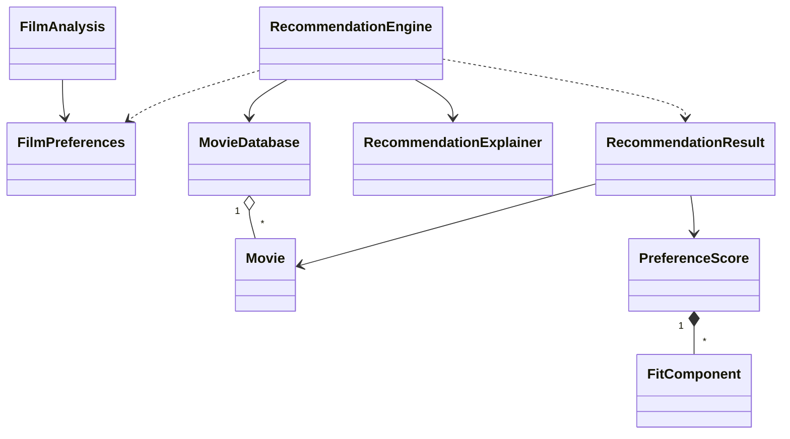
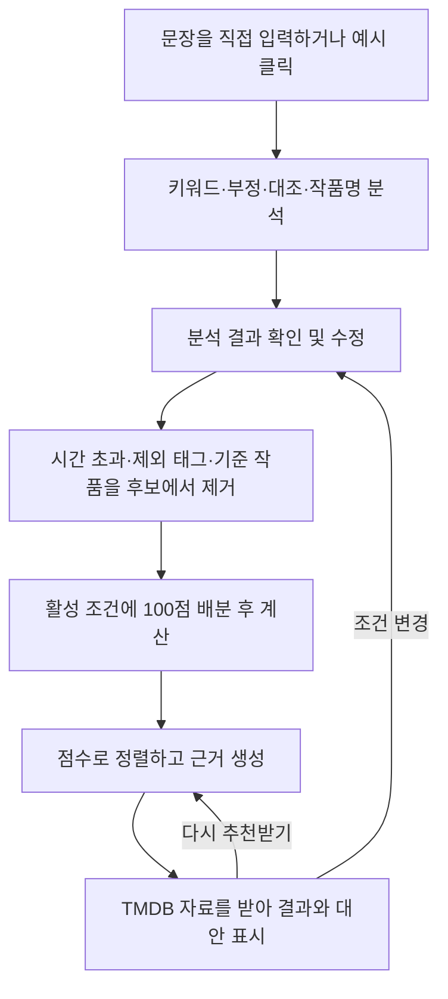

# SCENE 발표 준비 가이드

**지금 어떤 영화가 보고 싶나요?**

## 1. 문제와 목표

영화를 고르는 데 오래 걸리는 날에는 보고 싶은 조건이 한두 가지뿐인 경우가 있습니다. “영상미가 좋고 여운이 오래 남는 영화”처럼 원하는 내용을 그대로 쓰면, SCENE은 120편의 카탈로그에서 맞는 후보를 찾고 각 점수의 근거를 보여줍니다. 27편만 있던 때에는 장르가 맞아도 분위기나 러닝타임이 다른 대안이 자주 부족했습니다. 한국과 해외 영화, 여러 연대, 독립·예술영화까지 93편을 더해 비교할 수 있는 후보를 늘렸습니다.

> 처음에는 기분 선택으로 시작했지만, 친구와 볼 때나 특정 영화가 떠오를 때는 장르나 취향을 직접 말하는 편이 자연스러웠습니다. 그래서 문장을 분석하고, 제가 말한 조건으로만 점수가 계산되도록 바꿨습니다.

Python으로 규칙과 영화 데이터를 다루고, Streamlit으로 같은 코드를 바로 시연할 수 있는 웹 화면을 만들었습니다.

## 2. 객체지향 구조

| 클래스 또는 파일 | 역할 |
| --- | --- |
| `film_input.py`, `FilmAnalysis` | 문장 규칙과 카탈로그 제목을 이용해 편집 가능한 조건과 안내를 만듭니다. |
| `FilmPreferences` | 사용자가 확인한 선호·제외·시간 상한·관람 상황·비교 작품을 보관합니다. |
| `Movie`, `MovieDatabase` | 영화 한 편의 정보와 큐레이션을 표현하고 로컬 카탈로그를 읽습니다. |
| `RecommendationEngine` | 러닝타임과 제외 항목으로 후보를 걸러내고 점수 순으로 정렬합니다. |
| `preference_fit.py`, `PreferenceScore` | 활성 기준의 점수와 배점, 점수에 해당하는 근거를 기록합니다. |
| `RecommendationExplainer` | 작품별 특징과 점수 근거를 연결합니다. |
| `media.py`, `MovieMedia` | 추천 결과에 포스터·배경·줄거리·평점을 붙입니다. |

UI에서는 언급하지 않은 상세 조건을 미지정으로 둡니다. “머리 안 쓰고”는 부담 없는 관람에, “로맨틱 코미디”는 로맨스와 코미디에 해당합니다. “무섭지 않으면서 반전”은 무서운 분위기를 제외하고 반전은 선호로 구분합니다. 문장의 의미가 충분히 드러나지 않으면 적용할 조건을 추가하거나 수정할 수 있습니다.

### 영화에 붙인 정보

| 구분 | 담당 역할 |
| --- | --- |
| 제목, 연도, 러닝타임, 작품 ID | TMDB 영화 상세 응답과 대조합니다. |
| 세부 장르, 분위기, 영상미, 주제 | 작품의 줄거리와 연출 특징을 바탕으로 작성한 큐레이션입니다. |
| 전개 속도, 집중도, 감정 강도 | 전개는 세 단계, 집중도와 감정 강도는 1~5로 구분했습니다. 감정 강도는 작품의 좋고 나쁨을 뜻하지 않습니다. |
| 관람 상황과 유사 작품 | 시간대와 동반 관람 태그를 유지하고, 비슷한 장르·분위기·주제를 가진 작품을 연결했습니다. |

장르는 한 영화에 여러 개를 붙일 수 있습니다. 드라마 65편, 코미디 30편, 스릴러 28편, 로맨스와 SF 각각 23편, 미스터리 22편, 액션 20편, 범죄 18편, 판타지 15편, 공포와 애니메이션 각각 14편입니다. 독립영화 24편, 예술영화 11편, 느와르 13편과 한국 제작 참여 영화 18편이 포함됐습니다.

## 3. 동적 적합도를 설명하는 법

장르와 분위기의 기본 비중은 각각 5, 몰입도와 전개는 각각 3, 시간 상한·시간대·관람 형태는 각각 2, 유사 작품은 6입니다. 활성 조건만 남기고 합계가 100점이 되도록 환산합니다. 조건 간 최대 배점의 합이 반올림으로 어긋나지 않게 남은 점수는 나머지가 큰 항목부터 배분합니다.

“너무 집중해야 하는 영화보다 시간 보내기 좋은 액션 영화”의 경우 장르 39점, 분위기 38점, 몰입도 23점이 배정됩니다. 높은 집중은 제외 조건으로 적용되고, 관람 시간대와 러닝타임은 미지정입니다. 액션만 요청하면 장르에 100점이 배정됩니다. 장르와 분위기는 입력한 태그 중 작품과 겹치는 비율로 채점합니다.

“버닝처럼”이 들어오면 버닝을 후보에서 빼고 다른 영화와 비교합니다. 장르 25%, 분위기 35%, 주제 25%, 몰입도·전개 15%의 태그 겹침을 사용합니다. 연결해 둔 유사 작품에는 작은 보너스를 주고, 결과에 공통 태그를 보여줍니다. 점수가 같을 때는 요청을 포함한 고정 해시로 순서를 정합니다. 같은 요청을 다시 실행하면 다시 같은 순서가 나옵니다. 외부 평점이나 인기도는 추천 점수에 사용하지 않습니다.

## 4. 테스트와 실제 측정

Windows 11과 Python 3.14.3 환경에서 **pytest 43개가 통과**했습니다. `python validate_catalog.py`로 누락, 중복, 러닝타임, 태그 형식과 유사 영화 참조를 검사했습니다.

여덟 요청은 실행 전에 각각의 통과 기준을 정했습니다. 상위 세 편이 모두 조건에 맞을 때만 통과로 셌습니다. **8/8 통과(100%)**였으며, 추천 24자리에 서로 다른 24편이 나왔습니다. “버닝처럼” 요청에는 헤어질 결심 87점, 블레이드 러너 2049 84점, 벌새 80점이 나왔습니다. [여덟 요청의 분석, 상위 세 편, 근거와 조건 준수 여부](RECOMMENDATION_QA.md)

120편의 실제 TMDB 포스터와 배경, 한국어 줄거리 도입부를 조회했습니다. Edge의 1366×900과 390×844 화면에서 대안 두 편, 서로 다른 포스터·배경 이미지 렌더링, 다시 추천받기와 조건 변경을 확인했습니다. OMDb 키가 없어 외부 평점 동작은 테스트 응답으로 확인했습니다.

성능은 여덟 문장을 각각 125회씩 총 1,000회, 확장 전후에 같은 Python 코드로 측정했습니다. 문장 분석, 순위 산정과 이유 생성이 포함되고 TMDB 요청과 화면 렌더링은 제외됩니다.

| 카탈로그 | 평균 | 최소 | 최대 |
| --- | ---: | ---: | ---: |
| 확장 전 27편 | 0.783 ms | 0.412 ms | 32.634 ms |
| 확장 후 120편 | 2.770 ms | 1.503 ms | 13.096 ms |

기존 고정 배점 경로의 별도 비교에서 Python 평균 144.75 µs, C++ 평균 3.49 µs였고, 같은 후보의 순위와 항목별 점수가 모두 일치했습니다. C++ 비교에는 현재 문장 분석과 동적 배점이 포함되지 않습니다.

## 5. 배경 이미지와 구현 한계

TMDB 포스터는 작품 정보의 포스터 경로를 사용합니다. 배경은 별도로 이미지 목록을 조회합니다. 가로 비율, 해상도, 언어 태그를 살펴보고 포스터와 비슷한 구도를 제외합니다. 수동 경로를 지정할 수 있고, 적합한 이미지가 없으면 작품 정보만 보여주는 구성이 열립니다. TMDB 이미지에 “배경 이미지”라고 표시하는 이유는 이런 규칙으로 실제 영화 장면 여부를 확정할 수 없기 때문입니다.

복잡한 말의 맥락, 목록에 없는 작품 이름이나 평가 요소는 규칙이 놓칠 수 있습니다. 유사도는 카탈로그 태그에 의존합니다. 여덟 문장의 통과율은 정해진 기준으로 재현할 수 있는 검사 결과이며, 여러 관객이 추천에 만족할 확률을 의미하지 않습니다.
