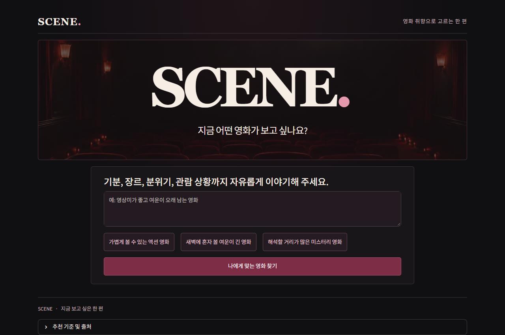
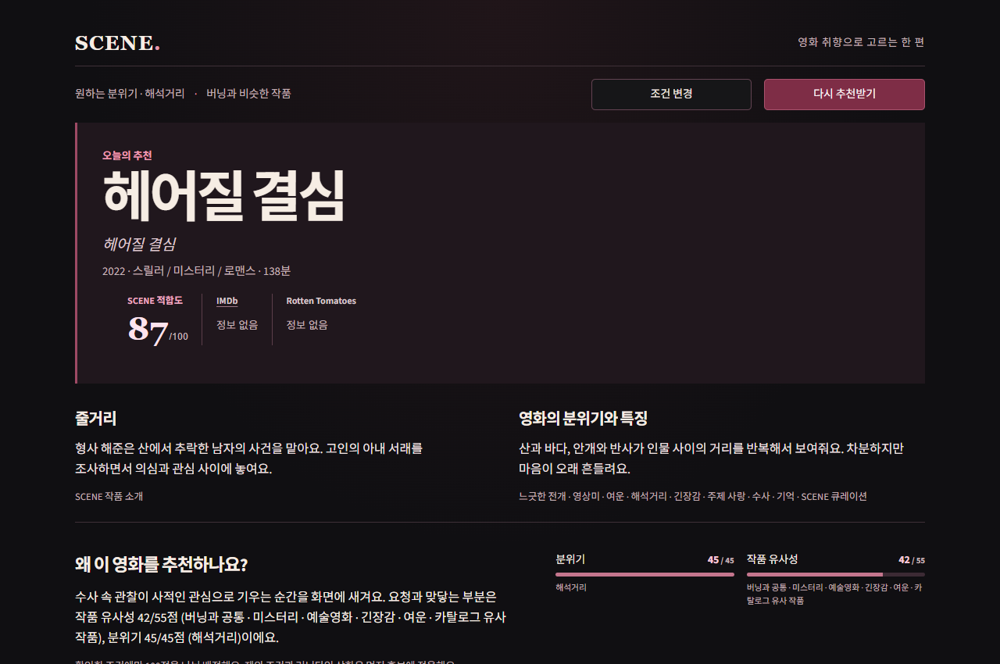

# SCENE

**지금 어떤 영화가 보고 싶나요?**

SCENE은 보고 싶은 영화를 한 문장으로 입력하면 **120편**의 카탈로그에서 추천 한 편과 대안 두 편을 보여주는 Streamlit 앱입니다. 대학교 객체지향프로그래밍 동아리 프로젝트로 만들었습니다.

## 개발 동기

영화를 보려고 목록을 둘러보다가 고르는 데만 30분 이상 걸린 적이 많았습니다. “오늘은 가볍게 웃을 수 있는 영화”처럼 원하는 게 한두 가지로 분명한 날에도, 여러 작품의 줄거리와 러닝타임을 따로 확인해야 했습니다. 그날 보고 싶은 조건을 한 문장으로 적고, 어떤 작품이 왜 맞는지 바로 비교할 수 있도록 SCENE을 만들었습니다.

## 주요 기능

- 자유 문장에서 장르, 분위기, 관람 상황과 제외 조건을 찾고 추천 전 직접 수정할 수 있습니다.
- 러닝타임 상한과 유사 작품 요청을 반영하고, 영화마다 **SCENE 적합도**와 근거를 보여줍니다.
- 추천 한 편과 대안 두 편의 줄거리와 큐레이션 설명을 비교하고, **다시 추천받기**로 다음 작품 묶음을 볼 수 있습니다.
- TMDB 키를 설정하면 포스터와 가로 배경을, OMDb 키를 설정하면 제공되는 IMDb·Rotten Tomatoes 평점을 함께 표시합니다.

## 실제 실행 화면

API 키 없이 실행한 화면입니다. 왼쪽은 취향 입력, 오른쪽은 “버닝처럼 해석할 거리가 많은 영화”를 입력한 추천 결과입니다.

| 취향 입력 | 추천 결과 |
| --- | --- |
|  |  |

## 시작하기

프로젝트 폴더에서 Python 3.11 이상으로 실행합니다.

```bash
git clone https://github.com/kyunho8962-dotcom/SCENE.git
cd SCENE
pip install -r requirements.txt
streamlit run app.py
```

터미널에 표시되는 로컬 주소를 브라우저에서 열면 됩니다. Windows PowerShell에서 프로젝트 전용 가상환경을 사용할 경우 다음 명령으로 실행할 수 있습니다.

```powershell
python -m venv .venv
.\.venv\Scripts\python.exe -m pip install -r requirements.txt
.\.venv\Scripts\python.exe -m streamlit run app.py
```

| 설정 | 사용할 수 있는 기능 |
| --- | --- |
| API 키 없이 실행 | 문장 분석, 로컬 영화 추천, 적합도와 추천 근거, 로컬 줄거리와 일부 스틸컷 |
| TMDB 인증 설정 | 포스터, 가로 배경, 한국어 줄거리 도입부 |
| OMDb 인증 설정 | 제공되는 IMDb 및 Rotten Tomatoes 평점 |

## 입력과 점수 계산

1. 보고 싶은 영화를 문장으로 적거나 첫 화면의 예시를 클릭합니다.
2. **나에게 맞는 영화 찾기**를 누르면 분석 결과가 나타납니다. 장르·분위기·몰입도·전개 속도의 선호와 제외를 각각 수정할 수 있습니다. 시간대, 관람 형태, 러닝타임 상한과 비슷한 작품은 **상세 조건**에서 조정합니다. 문장에서 찾지 못한 조건은 미지정으로 남습니다.
3. **추천 결과 보기**에서 영화별 실제 점수와 배점, 적용된 근거를 확인합니다. **다시 추천받기**로 다음 작품 묶음을 볼 수 있습니다.

문장 분석은 동의어, 간단한 부정 범위와 대조 구문을 사용합니다. 예를 들어 “집중해야 하는 영화보다 시간 보내기 좋은 액션”은 액션·가벼운 분위기·오락적 분위기·부담 없는 관람을 선호하고 높은 집중을 제외합니다. “버닝처럼”은 카탈로그의 버닝과 비교하라는 뜻으로 처리합니다. 추출 규칙에 없는 표현은 화면에서 적용 범위를 안내합니다. 확인한 조건이 하나도 없으면 추천 전 입력을 보완할 수 있습니다.

| 조건 | 기본 비중 |
| --- | ---: |
| 장르, 분위기 | 각 5 |
| 몰입도, 전개 속도 | 각 3 |
| 러닝타임 상한, 시간대, 관람 형태 | 각 2 |
| 작품 유사성 | 6 |

활성 항목의 기본 비중을 합계 100점으로 환산합니다. 예를 들어 장르만 지정하면 장르에 100점을 배정합니다. 장르·분위기·몰입도·전개는 요청한 태그의 일치 비율, 시간대와 관람 형태는 카탈로그의 0~5 등급을 사용합니다. 러닝타임 상한은 넘는 작품을 제외하고 남은 작품에 해당 배점을 줍니다. 제외 태그는 해당 작품을 후보에서 뺍니다. 제외만 지정한 경우 통과한 후보의 적합도는 모두 100점으로 동점입니다.

유사성은 기준 작품을 후보에서 제외하고, 장르 25%, 분위기 35%, 주제 25%, 몰입도·전개 15%의 태그 겹침을 비교합니다. 기준 작품의 유사 목록에 있는 영화에는 유사성 비율에 최대 0.10을 추가합니다. 총점이 같으면 요청 조건과 IMDb ID를 조합한 고정 해시로 정렬합니다. 같은 입력은 같은 결과를 내고, 서로 다른 입력의 동점 목록이 오래된 IMDb ID 순으로 반복되는 현상을 줄입니다. 인기도와 외부 평점은 점수와 동점 순서 모두에 사용하지 않습니다.

120편의 분위기·세부 장르와 주제, 전개 속도(`slow`, `medium`, `fast`), 집중도와 감정 강도(각 1~5), 영상미, 말투와 분위기, 작품별 큐레이터 설명을 기록했습니다. 집중도 1~2는 부담 없는 관람, 4~5는 높은 집중으로 분류합니다. 유사 작품 목록은 태그와 주제의 겹침을 기반으로 구성했고, 버닝에는 수사·고립·여운이 이어지는 작품을 별도로 연결했습니다. 이 특징과 관람 등급은 개발자의 주관적 큐레이션입니다.

## 선택 사항 · 포스터, 백드롭, 외부 평점

API 키 없이 추천을 사용할 수 있습니다. 스튜디오 지브리 작품 3편의 공식 스틸컷은 로컬에 포함되어 있습니다. 배경이 없으면 제목과 영화 정보가 바로 표시되고, 포스터가 없으면 포스터 영역이 접힙니다. 확인 가능한 평점이 없을 때는 `정보 없음`을 표시합니다. 결과의 **IMDb** 링크에서 해당 작품 페이지를 열 수 있습니다. 줄거리는 TMDB의 한국어 도입부를 우선 표시하고, 사용할 수 없으면 120편 모두에 준비한 스포일러 없는 한국어 소개를 사용합니다.

실시간 정보를 사용하려면 프로젝트 폴더에서 `.env.example`을 `.env`로 복사하고 발급받은 값을 입력하세요. 기존 `.env`가 있다면 그 파일을 편집하면 됩니다.

```powershell
if (-not (Test-Path .env)) { Copy-Item .env.example .env }
notepad .env
```

| 설정 | 값 |
| --- | --- |
| `TMDB_READ_TOKEN` | TMDB 계정 설정의 API 메뉴에서 발급받은 **API Read Access Token**. 포스터와 백드롭에 사용합니다. |
| `TMDB_API_KEY` | TMDB의 **v3 API Key**. 위 토큰 대신 입력할 수 있습니다. 둘 다 설정하면 토큰이 우선합니다. |
| `OMDB_API_KEY` | 발급 이메일에서 활성화한 OMDb API 키. 응답에 포함된 IMDb 및 Rotten Tomatoes 평점을 표시합니다. |

같은 이름의 값을 `.streamlit/secrets.toml`의 최상위 항목에도 넣을 수 있습니다. 환경 변수와 `.env`가 Streamlit secrets보다 우선합니다. 저장 후 서버를 재시작하고 결과 페이지를 열면 외부 조회가 시작됩니다. `.env`와 `.streamlit/secrets.toml`은 Git에서 제외됩니다. [TMDB 인증](https://developer.themoviedb.org/docs/authentication-application) · [OMDb 키 발급](https://www.omdbapi.com/apikey.aspx) · [Streamlit 비밀값 설정](https://docs.streamlit.io/develop/concepts/connections/secrets-management)

TMDB는 카탈로그에 TMDB ID가 있으면 해당 ID부터 확인하고, 그다음 IMDb ID로 조회합니다. ID로 찾은 작품도 원제와 개봉 연도를 맞춰 봅니다. 원제와 개봉 연도로 다시 검색한 후보는 IMDb ID가 같은 경우에만 사용합니다. 확인된 작품의 포스터·백드롭을 공식 CDN에서 받아 디코딩한 뒤 표시합니다. OMDb는 같은 IMDb ID를 반환한 응답에서 형식이 유효한 평점만 사용합니다. 제공자별·작품별 성공 응답은 메모리에서 1시간 재사용하고, 누락이나 실패가 있는 응답은 2분 뒤 다시 조회할 수 있습니다. [TMDB 작품 조회](https://developer.themoviedb.org/reference/find-by-id) · [TMDB CDN](https://developer.themoviedb.org/docs/image-basics) · [OMDb API](https://www.omdbapi.com/)

### 배경 이미지 선택

포스터는 작품의 `poster_path`를 사용합니다. 배경은 TMDB의 영화별 이미지 목록에서 960×480 이상, 가로세로비 1.55~2.6인 후보를 모읍니다. 언어 태그가 없는 이미지와 적절한 비율·해상도를 우선하고, 같은 경로나 축소·중앙 자르기 비교에서 포스터와 색상 배치가 비슷한 후보를 제외합니다. 최대 여섯 장을 확인하며, 남는 이미지가 없으면 로컬 공식 스틸컷이나 상단 배경이 없는 레이아웃을 사용합니다. [TMDB 영화 이미지 목록](https://developer.themoviedb.org/reference/movie-images)

작품별 수동 지정은 `data/movies.json`의 해당 작품에 `"backdrop_override": "/공식_TMDB_파일명.jpg"` 형태로 추가합니다. 값은 실제 TMDB 이미지 목록의 파일 경로로 교체합니다. 수동 이미지도 가로 비율과 포스터 유사성 검사를 거칩니다. 언어 태그와 구도는 장면에 가까운 후보를 고르기 위한 단서이며, 이 규칙만으로 실제 영화 장면인지 판별할 수는 없습니다. TMDB에서 가져온 이미지는 화면에 **배경 이미지 · TMDB**로 표시합니다. 사용이 허용된 지브리 로컬 자료는 스틸컷으로 표시합니다.

### 조회 문제 확인

추천 화면을 연 뒤 Streamlit 터미널을 확인하세요. 로그에는 제공자, 작업, IMDb ID 또는 HTTP 상태만 기록합니다.

| 로그 | 의미 |
| --- | --- |
| `credential_missing` | 해당 서비스의 설정값이 비어 있습니다. |
| `auth_failed` | 키가 거부되었습니다. 키 유형과 OMDb 키 활성화를 확인하세요. |
| `request_failed` | 통신, 응답 형식 또는 이미지 읽기에 실패했습니다. HTTP 상태가 있으면 함께 표시합니다. |
| `movie_not_found`, `movie_id_mismatch`, `movie_identity_mismatch` | 작품을 찾을 수 없거나 응답의 ID·원제·개봉 연도가 일치하지 않습니다. |
| `invalid_image_path` | 제공된 이미지 경로가 유효하지 않습니다. |

TMDB 설정 시 앱 하단에 공식 로고와 출처를 표시합니다. 키 없이 영화 이미지를 사용하려면 사용이 허용된 스틸컷이나 권리자가 별도로 허가한 자료를 사용하세요. 예를 들어 이터널 선샤인의 배급사 Focus Features는 공식 작품 페이지와 스틸컷 라이선스 신청 경로를 제공합니다. [TMDB 이미지 이용 및 출처 표기](https://developer.themoviedb.org/docs/faq) · [OMDb 콘텐츠 라이선스](https://creativecommons.org/licenses/by-nc/4.0/) · [이터널 선샤인 공식 페이지](https://www.focusfeatures.com/eternal_sunshine_of_the_spotless_mind) · [Focus Features 라이선스 안내](https://www.focusfeatures.com/contact)

## 사용 기술과 객체지향 구조

Python 3.11 이상과 Streamlit으로 구성했습니다. 영화 데이터는 JSON에 저장합니다. `python-dotenv`는 로컬 설정을 읽고, Pillow는 이미지를 확인하며, cachetools는 외부 조회 결과를 캐시합니다. pytest와 Streamlit의 AppTest로 코드와 화면 흐름을 검증합니다.

| 클래스 | 담당 역할 |
| --- | --- |
| `Movie` | 영화 한 편의 기본 정보와 태그, 유사 작품을 보관합니다. |
| `MovieDatabase` | JSON을 영화 객체로 읽고 러닝타임으로 후보를 걸러냅니다. |
| `FilmPreferences` | 문장에서 분석하고 사용자가 확인한 선호·제외·관람 조건을 담습니다. |
| `RecommendationEngine` | 후보들의 적합도를 계산하고 정렬해 추천 결과를 만듭니다. |
| `RecommendationExplainer` | 작품의 고유한 특징과 점수 근거를 연결합니다. |

### 주요 파일

| 파일 | 역할 |
| --- | --- |
| `app.py`, `result_view.py`, `style.css` | Streamlit 입력·탐색, 추천 화면 구성과 반응형 디자인 |
| `models.py` | 영화, 사용자 조건, 항목별 점수와 추천 결과를 표현하는 클래스 |
| `database.py` | 로컬 영화 목록 읽기, 러닝타임 필터 |
| `recommender.py` | 추천 후보 필터, 점수 계산, 정렬 |
| `film_input.py` | 장르·분위기·몰입도·전개·러닝타임·관람 상황·기준 작품 분석 |
| `preference_fit.py` | 활성 조건의 동적 배점과 작품 유사성 |
| `explainer.py` | 작품별 큐레이션과 실제 점수를 연결해 추천 이유 생성 |
| `media.py`, `static/` | 선택적 한국어 줄거리·이미지·평점 조회와 로컬 이미지 |
| `data/movies.json` | 영화 정보 120편과 큐레이션 등급·유사 작품 |
| `validate_catalog.py` | JSON 구조, 중복, 수치 범위, 유사 작품 참조, 장르 분포 검사 |
| `tests/` | 추천, 매체 응답 처리, Streamlit 조작 테스트 |
| `benchmark.py`, `benchmark.cpp` | Python 문장 추천 측정 및 기존 고정 배점 경로의 C++ 비교 |
| `PRESENTATION_GUIDE.md` | 발표 순서, Mermaid 클래스 다이어그램과 흐름도, 측정 결과 |

Python은 인공지능학과에서 배우는 언어를 실제 프로젝트에 적용하고 싶어 선택했습니다. 표준 라이브러리로 JSON을 읽어 데이터 클래스로 표현할 수 있고, Streamlit에서 같은 언어로 입력과 결과를 빠르게 연결할 수 있습니다. C++ 벤치마크는 순위 계산 비용을 비교하는 데 사용했습니다.

## 테스트와 성능 측정

```bash
python -m pytest -q
python validate_catalog.py
python -m pytest -q tests/test_catalog_quality.py
python benchmark.py
```

C++ 비교는 C++17 컴파일러가 있는 환경에서 실행합니다. Windows의 Visual Studio Developer Command Prompt에서는 다음처럼 빌드합니다.

```bat
cl /O2 /EHsc /std:c++17 benchmark.cpp
python benchmark.py --cpp benchmark.exe
```

GCC에서는 다음과 같습니다.

```bash
g++ -O2 -std=c++17 benchmark.cpp -o benchmark_cpp
python benchmark.py --cpp ./benchmark_cpp
```

Python 벤치마크는 여덟 문장을 각 125회 분석하고 추천합니다. `--baseline 기존카탈로그.json`을 주면 같은 코드로 확장 전후를 측정합니다. 선택 사항인 C++ 비교는 기존 고정 배점 호환 경로의 순위와 점수를 대조합니다. [발표 준비 가이드](PRESENTATION_GUIDE.md) · [여덟 요청의 품질 평가](RECOMMENDATION_QA.md)

## 데이터 및 이미지 출처

- 120편의 IMDb ID와 TMDB ID·원제·개봉 연도·러닝타임을 TMDB의 작품 응답으로 대조했습니다. 신규 작품의 연도와 러닝타임은 TMDB 대표 개봉일과 러닝타임 값을 사용했습니다. 한국어 제목은 익숙한 표기를 유지했고, 기존 작품의 러닝타임에는 앞서 확인한 국내 극장판 기준도 남겨 두었습니다. [TMDB ID 조회](https://developer.themoviedb.org/reference/find-by-id) · [TMDB 영화 상세](https://developer.themoviedb.org/reference/movie-details)

- 영화 식별자는 각 작품의 IMDb 제목 페이지에 대응합니다. 한국 영화의 러닝타임은 한국 극장판의 KOFIC 표기를 우선했습니다. 배급판과 복원판에 따라 분 단위 표기는 달라질 수 있습니다. 장르 선택과 줄거리 요약은 SCENE에서 작성했습니다. [IMDb](https://www.imdb.com/) · [KOFIC 버닝](https://www.koreanfilm.or.kr/eng/films/index/filmsView.jsp?movieCd=20173202) · [KOFIC 마더](https://www.koreanfilm.or.kr/eng/films/index/filmsView.jsp?movieCd=20090248) · [KOFIC 박쥐](https://www.koreanfilm.or.kr/view/news.jsp?category=IN_FOCUS&seq=354) · [KOFIC 기생충](https://www.koreanfilm.or.kr/eng/films/index/filmsView.jsp?movieCd=20183782) · [KOFIC 리틀 포레스트](https://www.koreanfilm.or.kr/eng/films/index/filmsView.jsp?movieCd=20170841) · [Criterion 12인의 성난 사람들](https://www.criterion.com/films/27871-12-angry-men)
- 세 작품의 스틸컷은 통상적인 범위에서 사용을 허용하는 Studio Ghibli 공식 작품 페이지의 공개 스틸컷입니다. 각 이미지의 권리는 해당 작품의 권리자에게 있습니다. [이웃집 토토로](https://www.ghibli.jp/works/totoro/) · [마녀 배달부 키키](https://www.ghibli.jp/works/majo/) · [센과 치히로의 행방불명](https://www.ghibli.jp/works/chihiro/)
- 시작 화면의 극장 배경은 SCENE을 위해 생성한 이미지입니다. 작품의 포스터 및 백드롭은 설정한 경우 TMDB에서 표시합니다. [TMDB 이미지 문서](https://developer.themoviedb.org/docs/image-basics) · [TMDB 공식 로고](https://www.themoviedb.org/about/logos-attribution)
- 추가한 액션 3편의 작품 정보는 제작·배급사의 자료를 참고했습니다. [베이비 드라이버](https://www.sonypictures.com/movies/babydriver) · [스파이더맨: 뉴 유니버스](https://dev.sonypictures.com/movies/spidermanintothespiderverse) · [쥬만지: 새로운 세계](https://www.sonypictures.com/movies/jumanjiwelcometothejungle)

## 한계

키워드에 없는 표현, 복잡한 문장, 목록 밖의 비교 작품은 해석이 제한됩니다. 적합도는 사전 정의된 배점과 큐레이션에 따라 계산됩니다. 여덟 문장의 회귀 테스트는 분류 규칙과 실제 추천 결과를 검증하며, 관객 만족도를 측정하지는 않습니다. 외부 평점은 OMDb 키, 배경은 TMDB 이미지 후보에 의존합니다.
